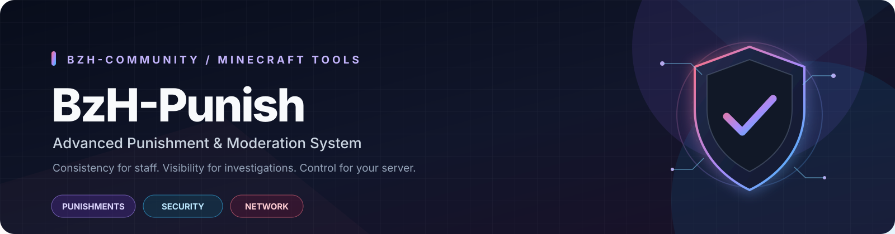

  
   
  
<strong>Advanced punishment, moderation, and security tools for Minecraft servers.</strong>

  

    
    
    
    
  

  

    <a href="../../releases">⬇️ Download</a> ·
    <a href="#-features">✨ Features</a> ·
    <a href="#-installation">🚀 Installation</a> ·
    <a href="#-commands">⌨️ Commands</a> ·
    <a href="#-support">🛠️ Support</a>
  

---

## Overview

**BzH-Punish** is a moderation toolkit built for Minecraft server staff who need a consistent way to manage punishments, investigate player activity, and maintain server rules. It brings punishment commands, reusable templates, player history, freeze tools, security monitoring, and flexible storage into one plugin.

> **Built for staff. Designed for control. Made to scale.**

## ✨ Features

<table>
  <tr>
    <td width="50%" valign="top">
      <h3>⚖️ Punishment Management</h3>
      Ban, temporary ban, mute, temporary mute, warn, kick, IP ban, IP mute, and their supported removal commands.
    </td>
    <td width="50%" valign="top">
      <h3>📋 Reusable Templates</h3>
      Create and manage punishment templates, inspect template details, and apply consistent staff actions.
    </td>
  </tr>
  <tr>
    <td width="50%" valign="top">
      <h3>📚 Player History</h3>
      Review punishment history with pagination and configurable history limits; clear history with permission.
    </td>
    <td width="50%" valign="top">
      <h3>❄️ Investigation Freeze</h3>
      Freeze players during investigations and unfreeze them when staff work is complete.
    </td>
  </tr>
  <tr>
    <td width="50%" valign="top">
      <h3>🗄️ Flexible Storage</h3>
      Choose SQLite for a straightforward setup or MySQL for database-backed deployments.
    </td>
    <td width="50%" valign="top">
      <h3>🛡️ Security Monitoring</h3>
      Security flags, staff notifications, logging, configurable thresholds, and IP whitelist management.
    </td>
  </tr>
  <tr>
    <td width="50%" valign="top">
      <h3>🌐 Optional Network Sync</h3>
      Shared-MySQL synchronization for supported punishment states across participating Paper servers.
    </td>
    <td width="50%" valign="top">
      <h3>🔌 Developer API</h3>
      API access and custom events for integrations with other plugins.
    </td>
  </tr>
</table>

## 📦 Requirements

- **Java:** 17 or newer compatible runtime
- **Server API target:** Paper API 1.20.6
- **Server compatibility:** The project declares Minecraft API version `1.20`; test your specific server software and version before production use.

## 🚀 Installation

1. Download the latest `.jar` from **[Releases](../../releases)**.
2. Stop your Minecraft server.
3. Put the JAR in the server's `plugins/` directory.
4. Start the server and wait for plugin initialization.
5. Review the generated files in `plugins/BzH-Punish/`, including `config.yml`.
6. Configure permissions for your staff roles.
7. Test moderation commands and database persistence on a test server before deploying to production.

**Updating:** Back up your configuration and database before replacing an existing version.

## ⚙️ Configuration

BzH-Punish generates a configuration with options covering the following areas:

| Area | Available settings |
|---|---|
| Storage | SQLite or MySQL connection settings |
| Punishments | Ban-related player handling, broadcasts, and default reason |
| Warnings | Target notifications, warning count display, and maximum warning setting |
| Cooldowns | Enable/disable and duration |
| History | Default and maximum page limits |
| Date & time | Date format and timezone |
| Cleanup | Enable/disable and cleanup interval |
| Security | Staff notifications, file logging, IP-change threshold, and accounts-per-IP threshold |
| Network | Optional shared-MySQL synchronization and polling interval |

Use the generated configuration as the source of truth for exact keys and defaults. **Never publish database passwords or other secrets.**

## ⌨️ Commands

The main command is `/bpunish`. The plugin also registers convenient standalone aliases.

| Command | Purpose |
|---|---|
| `/bpunish` | Show command help |
| `/bpunish ban <player> <time> <reason>` | Ban a player |
| `/bpunish mute <player> <time> <reason>` | Mute a player |
| `/bpunish warn <player> <reason>` | Warn a player |
| `/bpunish kick <player> <reason>` | Kick a player |
| `/bpunish ipban <player> <time> <reason>` | Apply an IP ban |
| `/bpunish ipmute <player> <time> <reason>` | Apply an IP mute |
| `/bpunish unban <player>` | Remove a ban |
| `/bpunish unmute <player>` | Remove a mute |
| `/bpunish unwarn <player> [amount]` | Remove warnings |
| `/bpunish ipunban <ip\|player>` | Remove an IP ban |
| `/bpunish ipunmute <ip>` | Remove an IP mute |
| `/bpunish history <player> [page]` | View punishment history |
| `/bpunish clearhistory <player>` | Clear punishment history |
| `/bpunish unpunish <player> <template>` | Remove a supported punishment via template |
| `/bpunish freeze <player> [reason]` | Freeze a player |
| `/bpunish unfreeze <player>` | Unfreeze a player |
| `/bpunish reload` | Reload plugin configuration |
| `/bpunish security` | Open security tools |
| `/bpunish template` | Open template tools |
| `/punish <player> <template> [reason]` | Apply a punishment template |

**Aliases:** `/bzhpunish`, `/bp`, `/ban`, `/mute`, `/ipban`, `/ipmute`, `/history`, `/unpunish`, `/warn`, `/kick`, `/unban`, `/unmute`, `/unwarn`, `/ipunban`, `/ipunmute`, `/clearhistory`, `/security`, `/freeze`, and `/unfreeze`.

> Command syntax can vary by subcommand and version. Use `/bpunish` and in-game tab completion to confirm the syntax available on your server.

## 🔐 Permissions

Permissions are registered under the `bzhpunish.*` namespace. By default, most moderation permissions are operator-only.

| Permission | Purpose |
|---|---|
| `bzhpunish.*` | Main wildcard; grants the listed child permissions |
| `bzhpunish.ban` | Ban players |
| `bzhpunish.mute` | Mute players |
| `bzhpunish.warn` | Warn players |
| `bzhpunish.kick` | Kick players |
| `bzhpunish.ipban` | Apply IP bans |
| `bzhpunish.ipmute` | Apply IP mutes |
| `bzhpunish.unban` | Remove bans |
| `bzhpunish.unmute` | Remove mutes |
| `bzhpunish.unwarn` | Remove warnings |
| `bzhpunish.ipunban` | Remove IP bans |
| `bzhpunish.ipunmute` | Remove IP mutes |
| `bzhpunish.unpunish` | Remove supported punishments |
| `bzhpunish.history` | View player histories |
| `bzhpunish.clearhistory` | Clear player histories |
| `bzhpunish.reload` | Reload configuration |
| `bzhpunish.freeze` | Freeze players |
| `bzhpunish.unfreeze` | Unfreeze players |
| `bzhpunish.template.create` | Create templates |
| `bzhpunish.template.delete` | Delete templates |
| `bzhpunish.template.list` | List templates |
| `bzhpunish.template.info` | View template details |
| `bzhpunish.template.reload` | Reload templates |
| `bzhpunish.security` | Access security commands |
| `bzhpunish.security.notify` | Receive security notifications |
| `bzhpunish.admin` | Administrative access |
| `bzhpunish.notify` | Receive punishment broadcasts |
| `bzhpunish.template.*` | Template permission wildcard |
| `bzhpunish.unpunish.template.*` | Template-based unpunish wildcard |

Assign only the permissions each staff role needs. Review `plugin.yml` and test permission behavior before using these nodes on a production server.

## 🗄️ Storage Setup

### SQLite

SQLite is the simplest starting point for a single-server setup. The default configuration uses SQLite and stores data in `punishments.db`.

### MySQL

1. Create a database and a dedicated database user.
2. Set the host, port, database name, username, and password in `config.yml`.
3. Ensure the Minecraft server can reach the database host.
4. Restart the server and check the console for database initialization errors.
5. Test persistence by restarting the server and checking punishment records.

Do not commit a configuration containing real credentials to a public repository.

## 🌐 Multi-Server Setup

An optional network synchronization setting is provided for supported deployments using a shared MySQL database, such as multiple Paper backends behind Velocity.

1. Configure each participating server to use the same intended MySQL database.
2. Verify database connectivity and permissions from every backend.
3. Enable the `network` setting in each server's configuration and review `poll-seconds`.
4. Test punishment creation and removal across the network.
5. Monitor server logs for synchronization or database errors.

Network synchronization is limited to supported states and behaviors. Verify each workflow in your environment rather than assuming every plugin action is synchronized.

## 🧑‍💻 Developer API

The project includes API/event classes for integrations:

- `com.bzh.punish.api.BzHPunishAPI`
- `com.bzh.punish.api.event.PlayerPunishEvent`
- `com.bzh.punish.api.event.PlayerUnpunishEvent`

Refer to the source code for exact method signatures, event properties, and integration details.

## 🛠️ Support

When opening a bug report, include:

- Minecraft server software and version
- Java version
- BzH-Punish version
- Relevant console errors or stack traces
- Steps to reproduce the issue
- Relevant configuration with passwords and other secrets removed

Please do not include database passwords, tokens, private player information, or other sensitive data in issues.

## ❤️ Credits

Developed by **BzH-Community**.

Thanks for checking out BzH-Punish! Feedback, bug reports, and suggestions are welcome.

---

  Made for better moderation workflows · BzH-Community

